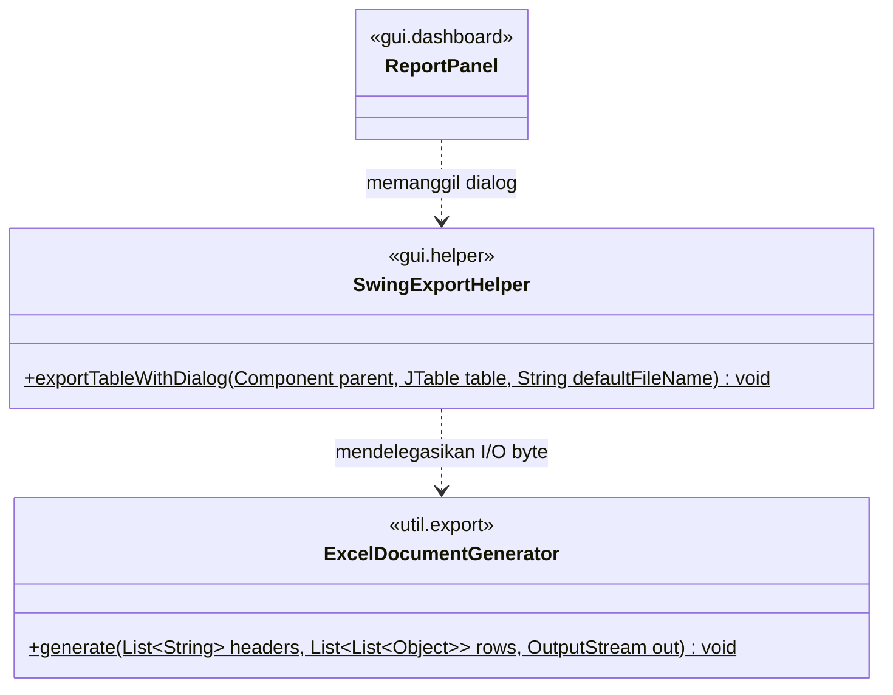
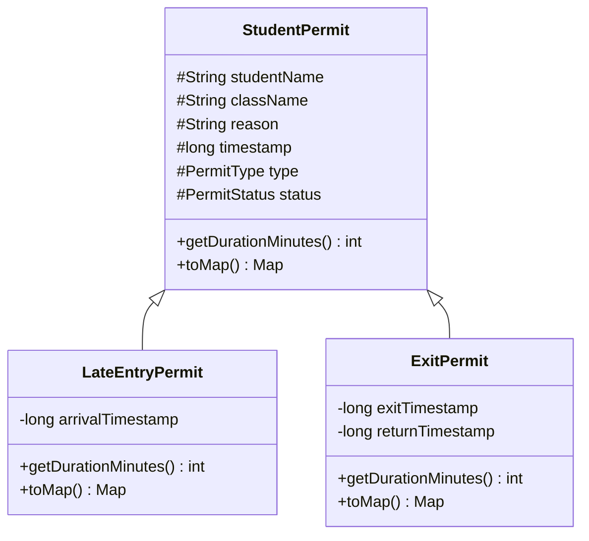
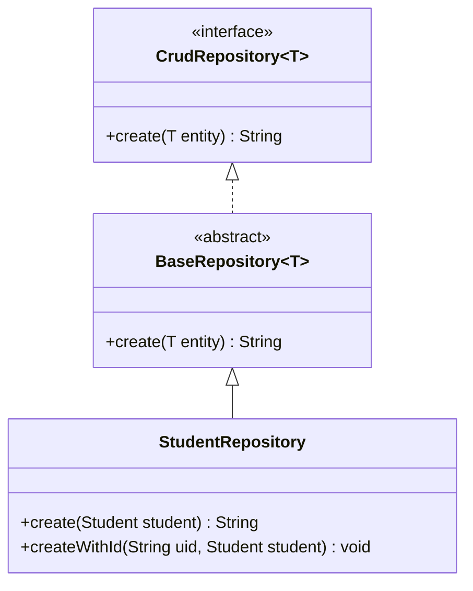
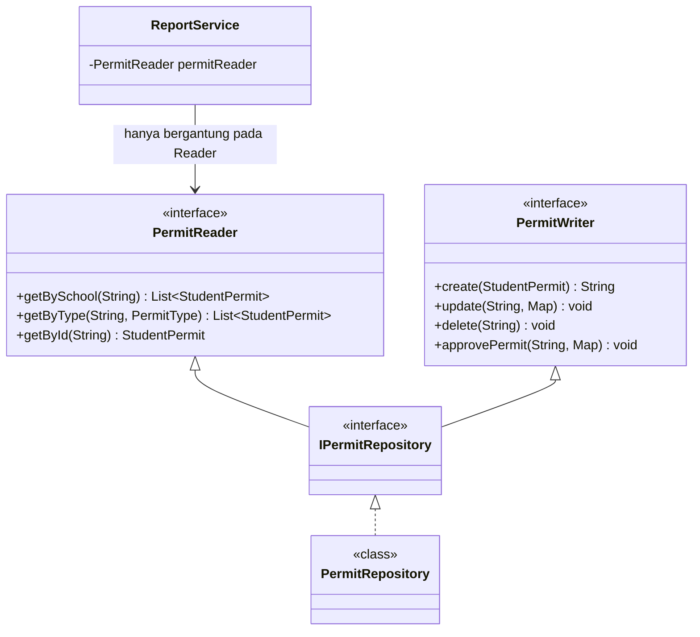
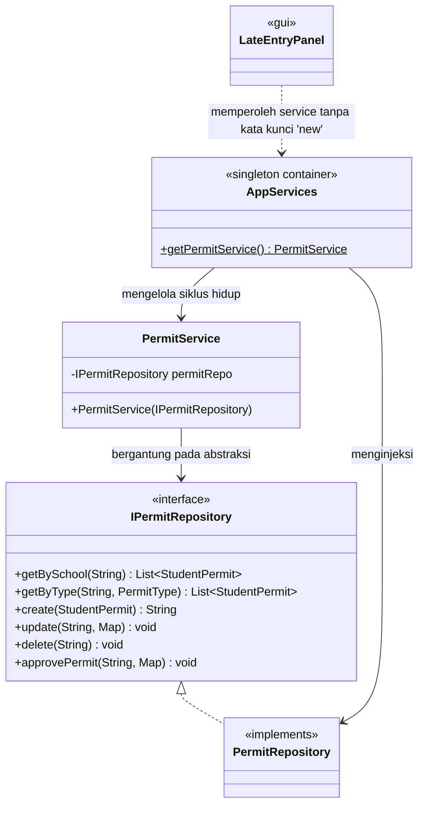

# 🛠️ Rencana Refactoring Prinsip SOLID (Seleksi Kasus Terbaik)
**Mata Kuliah:** Analisis dan Desain Perangkat Lunak (ADPL)  
**Proyek:** SmartSchool Permit System (TubesPBO)  
**Tujuan Dokumen:** Seleksi 5 kasus refactoring terbaik berbasis prinsip SOLID untuk laporan dan materi presentasi UTS ADPL, lengkap dengan perbandingan mendalam *BEFORE* vs *AFTER*, analisis risiko, dan rencana pengujian.  
**Status Tindakan:** Proposal Rencana (Tanpa Modifikasi Source Code) — Menunggu Persetujuan.

---

## 📋 Ringkasan Seleksi Kasus Terbaik

Berdasarkan hasil audit menyeluruh pada [`docs/solid-audit.md`](file:///d:/Project/Kuliah/DPBO/TubesPBO/docs/solid-audit.md), dipilih **5 kasus refactoring unggulan** yang secara harmonis merepresentasikan kelima huruf **S-O-L-I-D**. Seluruh kasus dipilih berdasarkan 5 kriteria utama penugasan UTS ADPL:
1. **Bukti Validitas Source Code:** Pelanggaran nyata dan terverifikasi dari baris kode proyek aktual.
2. **Kontras BEFORE vs AFTER:** Perbedaan desain sebelum dan sesudah refactoring terlihat kontras dan mudah dipresentasikan.
3. **Bobot Akademik:** Menerapkan pola desain perangkat lunak (*design pattern*) standar industri yang diajarkan pada kurikulum ADPL.
4. **Keamanan Eksekusi (Low Blast Radius):** Perubahan terisolasi, menjaga kompatibilitas ke belakang (*backward compatibility*), dan tidak merusak skema database Firestore.
5. **Dampak Nyata terhadap Maintainability & Testability:** Menjadikan sistem dapat diuji (*unit-testable*) dan mudah diperluas di masa depan.

```
┌──────────────────────────────────────────────────────────────────────────────────────────────┐
│                            MATRIKS SELEKSI 5 KASUS TERBAIK UTS                               │
├──────┬──────────────┬──────────────────────────────────────────┬─────────────────────────────┤
│ No   │ Prinsip      │ Judul Kasus                              │ File Fokus Utama            │
├──────┼──────────────┼──────────────────────────────────────────┼─────────────────────────────┤
│ 1    │ **SRP**      │ Dekopling Modul Ekspor Excel dari UI     │ util/XlsxUtils.java         │
│ 2    │ **OCP**      │ Polimorfisme Kalkulasi Durasi Izin       │ model/StudentPermit.java    │
│ 3    │ **LSP**      │ Harmonisasi Kontrak Persistensi Entitas  │ repository/BaseRepository   │
│ 4    │ **ISP**      │ Segregasi Interface Reader untuk Laporan │ repository/CrudRepository   │
│ 5    │ **DIP**      │ Abstraksi Repository pada Service Layer  │ service/PermitService.java  │
└──────┴──────────────┴──────────────────────────────────────────┴─────────────────────────────┘
```

---

## 🔍 Detail Kasus 1: Single Responsibility Principle (SRP)

### 1.1 Judul Kasus
**Pemisahan Tanggung Jawab Ekspor Berkas Excel dari Lapisan Antarmuka Grafis (Swing GUI)**

### 1.2 Prinsip SOLID
**Single Responsibility Principle (SRP)** — *Satu kelas hanya boleh memiliki satu alasan untuk berubah.*

### 1.3 File yang Terdampak
- File Utama: [`src/main/java/com/smartschool/permit/tubespbo/util/XlsxUtils.java`](file:///d:/Project/Kuliah/DPBO/TubesPBO/src/main/java/com/smartschool/permit/tubespbo/util/XlsxUtils.java#L16-L84)
- File Konsumen: [`src/main/java/com/smartschool/permit/tubespbo/gui/dashboard/ReportPanel.java`](file:///d:/Project/Kuliah/DPBO/TubesPBO/src/main/java/com/smartschool/permit/tubespbo/gui/dashboard/ReportPanel.java#L52)

### 1.4 Source Code BEFORE
```java
// Lokasi: com.smartschool.permit.tubespbo.util.XlsxUtils.java (Baris 16-84)
package com.smartschool.permit.tubespbo.util;

import org.apache.poi.ss.usermodel.*;
import org.apache.poi.xssf.usermodel.XSSFWorkbook;
import javax.swing.*;
import javax.swing.table.TableModel;
import java.io.File;
import java.io.FileOutputStream;

public class XlsxUtils {

    public static void exportTable(JTable table, String defaultFileName) {
        // [TANGGUNG JAWAB 1: Interaksi UI File Chooser]
        JFileChooser fileChooser = new JFileChooser();
        fileChooser.setDialogTitle("Simpan Laporan Excel");
        fileChooser.setSelectedFile(new File(defaultFileName + ".xlsx"));

        int userSelection = fileChooser.showSaveDialog(null);
        if (userSelection != JFileChooser.APPROVE_OPTION) {
            return;
        }

        File fileToSave = fileChooser.getSelectedFile();
        if (!fileToSave.getName().toLowerCase().endsWith(".xlsx")) {
            fileToSave = new File(fileToSave.getAbsolutePath() + ".xlsx");
        }

        // [TANGGUNG JAWAB 2 & 3: Ekstraksi Data Swing TableModel & Formatting Apache POI]
        try (Workbook workbook = new XSSFWorkbook()) {
            Sheet sheet = workbook.createSheet("Laporan");
            TableModel model = table.getModel();

            Font headerFont = workbook.createFont();
            headerFont.setBold(true);
            CellStyle headerStyle = workbook.createCellStyle();
            headerStyle.setFont(headerFont);
            headerStyle.setFillForegroundColor(IndexedColors.GREY_25_PERCENT.getIndex());
            headerStyle.setFillPattern(FillPatternType.SOLID_FOREGROUND);

            Row headerRow = sheet.createRow(0);
            for (int col = 0; col < model.getColumnCount(); col++) {
                Cell cell = headerRow.createCell(col);
                cell.setCellValue(model.getColumnName(col));
                cell.setCellStyle(headerStyle);
            }

            for (int row = 0; row < model.getRowCount(); row++) {
                Row excelRow = sheet.createRow(row + 1);
                for (int col = 0; col < model.getColumnCount(); col++) {
                    Object value = model.getValueAt(row, col);
                    if (value != null) {
                        if (value instanceof Number) {
                            excelRow.createCell(col).setCellValue(((Number) value).doubleValue());
                        } else {
                            excelRow.createCell(col).setCellValue(value.toString());
                        }
                    }
                }
            }

            for (int col = 0; col < model.getColumnCount(); col++) {
                sheet.autoSizeColumn(col);
            }

            // [TANGGUNG JAWAB 4 & 5: File I/O Disk & UI Notification Dialog]
            try (FileOutputStream fileOut = new FileOutputStream(fileToSave)) {
                workbook.write(fileOut);
                JOptionPane.showMessageDialog(null, 
                        "Laporan berhasil diexport ke:\n" + fileToSave.getAbsolutePath(), 
                        "Sukses", JOptionPane.INFORMATION_MESSAGE);
            }

        } catch (Exception e) {
            JOptionPane.showMessageDialog(null, 
                    "Gagal export Excel: " + e.getMessage(), 
                    "Error", JOptionPane.ERROR_MESSAGE);
            e.printStackTrace();
        }
    }
}
```

### 1.5 Analisis Masalah
Kelas `XlsxUtils` saat ini memikul 5 tanggung jawab sekaligus dalam satu static method:
1. **Presentasi Dialog File:** Menampilkan dan mengelola input pengguna via `JFileChooser`.
2. **Ketergantungan Model Swing:** Mengikat logika ekspor ke komponen visual `JTable` dan `TableModel`.
3. **Pembangkitan Dokumen Excel:** Mengonstruksi lembar kerja, baris, sel, font, dan pewarnaan via Apache POI.
4. **Operasi I/O Fisik:** Membuka `FileOutputStream` dan menulis byte ke media penyimpanan lokal.
5. **Presentasi Dialog Hasil:** Memunculkan pop-up modal `JOptionPane` (baik status sukses maupun pesan error).

**Dampak Arsitektural:**
- **Zero Testability:** Method ini mustahil diuji secara otomatis (*automated headless unit test*) karena akan melempar `java.awt.HeadlessException` di server CI/CD saat memanggil dialog GUI.
- **Zero Reusability:** Tidak dapat digunakan untuk mengekspor data mentah `List<StudentPermit>` atau data dari service non-GUI.

### 1.6 Desain Solusi
Pisahkan kelas menjadi dua komponen independen dengan batasan tanggung jawab yang tegas:
1. **`ExcelDocumentGenerator` (Core Utility):** Hanya bertanggung jawab menerima data murni (header berupa `List<String>`, baris berupa `List<List<Object>>`, dan target `OutputStream`) lalu menghasilkan file Excel tanpa menyentuh pustaka `javax.swing.*`.
2. **`SwingExportHelper` (GUI Presentation Helper):** Bertanggung jawab menangani alur interaksi pengguna (dialog pemilihan file, ekstraksi data dari `JTable`, pemanggilan `ExcelDocumentGenerator`, dan dialog notifikasi hasil).

### 1.7 Struktur Class AFTER


### 1.8 Source Code AFTER yang Direncanakan
#### A. Kelas Pembangkit Dokumen Murni: `util/export/ExcelDocumentGenerator.java`
```java
package com.smartschool.permit.tubespbo.util.export;

import org.apache.poi.ss.usermodel.*;
import org.apache.poi.xssf.usermodel.XSSFWorkbook;
import java.io.IOException;
import java.io.OutputStream;
import java.util.List;

/**
 * Komponen murni pembuat format berkas Excel (Apache POI).
 * Independen dari pustaka UI Swing.
 */
public final class ExcelDocumentGenerator {

    private ExcelDocumentGenerator() {} // Mencegah instansiasi utility

    public static void generate(List<String> headers, List<List<Object>> rows, OutputStream out) throws IOException {
        try (Workbook workbook = new XSSFWorkbook()) {
            Sheet sheet = workbook.createSheet("Laporan");

            // Header Style
            Font headerFont = workbook.createFont();
            headerFont.setBold(true);
            CellStyle headerStyle = workbook.createCellStyle();
            headerStyle.setFont(headerFont);
            headerStyle.setFillForegroundColor(IndexedColors.GREY_25_PERCENT.getIndex());
            headerStyle.setFillPattern(FillPatternType.SOLID_FOREGROUND);

            // Write Headers
            Row headerRow = sheet.createRow(0);
            for (int col = 0; col < headers.size(); col++) {
                Cell cell = headerRow.createCell(col);
                cell.setCellValue(headers.get(col));
                cell.setCellStyle(headerStyle);
            }

            // Write Data
            for (int r = 0; r < rows.size(); r++) {
                Row row = sheet.createRow(r + 1);
                List<Object> rowData = rows.get(r);
                for (int c = 0; c < rowData.size(); c++) {
                    Object val = rowData.get(c);
                    if (val != null) {
                        Cell cell = row.createCell(c);
                        if (val instanceof Number) {
                            cell.setCellValue(((Number) val).doubleValue());
                        } else {
                            cell.setCellValue(val.toString());
                        }
                    }
                }
            }

            for (int col = 0; col < headers.size(); col++) {
                sheet.autoSizeColumn(col);
            }

            workbook.write(out);
        }
    }
}
```

#### B. Kelas Helper UI Swing: `gui/helper/SwingExportHelper.java`
```java
package com.smartschool.permit.tubespbo.gui.helper;

import com.smartschool.permit.tubespbo.util.export.ExcelDocumentGenerator;
import javax.swing.*;
import javax.swing.table.TableModel;
import java.awt.Component;
import java.io.File;
import java.io.FileOutputStream;
import java.util.ArrayList;
import java.util.List;

/**
 * Helper khusus menangani integrasi JTable dan dialog Swing dengan ExcelDocumentGenerator.
 */
public class SwingExportHelper {

    public static void exportTableWithDialog(Component parent, JTable table, String defaultFileName) {
        JFileChooser fileChooser = new JFileChooser();
        fileChooser.setDialogTitle("Simpan Laporan Excel");
        fileChooser.setSelectedFile(new File(defaultFileName + ".xlsx"));

        if (fileChooser.showSaveDialog(parent) != JFileChooser.APPROVE_OPTION) {
            return;
        }

        File targetFile = fileChooser.getSelectedFile();
        if (!targetFile.getName().toLowerCase().endsWith(".xlsx")) {
            targetFile = new File(targetFile.getAbsolutePath() + ".xlsx");
        }

        try {
            TableModel model = table.getModel();
            List<String> headers = new ArrayList<>();
            for (int c = 0; c < model.getColumnCount(); c++) {
                headers.add(model.getColumnName(c));
            }

            List<List<Object>> rows = new ArrayList<>();
            for (int r = 0; r < model.getRowCount(); r++) {
                List<Object> rowData = new ArrayList<>();
                for (int c = 0; c < model.getColumnCount(); c++) {
                    rowData.add(model.getValueAt(r, c));
                }
                rows.add(rowData);
            }

            try (FileOutputStream fos = new FileOutputStream(targetFile)) {
                ExcelDocumentGenerator.generate(headers, rows, fos);
            }

            JOptionPane.showMessageDialog(parent, 
                    "Laporan berhasil diexport ke:\n" + targetFile.getAbsolutePath(), 
                    "Sukses", JOptionPane.INFORMATION_MESSAGE);

        } catch (Exception ex) {
            JOptionPane.showMessageDialog(parent, 
                    "Gagal export Excel: " + ex.getMessage(), 
                    "Error", JOptionPane.ERROR_MESSAGE);
        }
    }
}
```

### 1.9 Mengapa Solusi Menerapkan Prinsip SOLID
- **Satu Alasan untuk Berubah:** Jika aturan tampilan Excel (warna, font) berubah, hanya `ExcelDocumentGenerator` yang diedit. Jika tata cara prompt dialog pengguna berubah, hanya `SwingExportHelper` yang diedit.
- **Peningkatan Testability:** `ExcelDocumentGenerator.generate(...)` kini dapat diuji menggunakan `ByteArrayOutputStream` dalam unit test murni tanpa perlu menginisialisasi komponen GUI.

### 1.10 Risiko dan Kebutuhan Pengujian
- **Risiko:** Sangat rendah. Tidak ada interaksi database atau perubahan struktur data domain.
- **Kebutuhan Pengujian:**
  1. *Unit Test:* Eksekusi `ExcelDocumentGenerator.generate(...)` dengan mock header dan baris, lalu pastikan ukuran byte output stream > 0.
  2. *Manual Integration Test:* Buka `ReportPanel`, klik tombol "Export XLSX", simpan file, lalu buka file menggunakan Microsoft Excel / LibreOffice Calc untuk memastikan format tabel dan nilai numerik tampil rapi.

---

## 🔍 Detail Kasus 2: Open/Closed Principle (OCP)

### 2.1 Judul Kasus
**Penerapan Polimorfisme pada Penghitungan Durasi dan Atribut Entitas Izin Siswa**

### 2.2 Prinsip SOLID
**Open/Closed Principle (OCP)** — *Entitas perangkat lunak harus terbuka untuk perluasan (open for extension), namun tertutup untuk modifikasi (closed for modification).*

### 2.3 File yang Terdampak
- File Utama: [`src/main/java/com/smartschool/permit/tubespbo/model/StudentPermit.java`](file:///d:/Project/Kuliah/DPBO/TubesPBO/src/main/java/com/smartschool/permit/tubespbo/model/StudentPermit.java#L49-L70, #L87-L93)

### 2.4 Source Code BEFORE
```java
// Lokasi: com.smartschool.permit.tubespbo.model.StudentPermit.java (Baris 52-70, 87-93)
public int getDurationMinutes() {
    ZoneId zone = ZoneId.of("Asia/Jakarta");
    ZonedDateTime zdt = Instant.ofEpochMilli(timestamp).atZone(zone);
    
    // [PELANGGARAN OCP: Percabangan manual bertingkat berbasis tipe izin]
    if (isLateEntry()) {
        ZonedDateTime sevenAm = zdt.withHour(7).withMinute(0).withSecond(0).withNano(0);
        long diff = timestamp - sevenAm.toInstant().toEpochMilli();
        return (int) Math.max(0, diff / 60000);
    } else if (isExitPermit()) {
        if (returnTimestamp > 0) {
            return (int) ((returnTimestamp - timestamp) / 60000);
        } else {
            ZonedDateTime threePm = zdt.withHour(15).withMinute(0).withSecond(0).withNano(0);
            long diff = threePm.toInstant().toEpochMilli() - timestamp;
            return (int) Math.max(0, diff / 60000);
        }
    }
    return 0;
}

@Override
public Map<String, Object> toMap() {
    Map<String, Object> map = new HashMap<>();
    // ... field dasar ...

    // [PELANGGARAN OCP: Percabangan manual untuk mapping field spesifik]
    if (isLateEntry()) {
        if (arrivalTimestamp > 0) map.put("arrivalTimestamp", arrivalTimestamp);
    } else if (isExitPermit()) {
        if (returnTimestamp > 0) map.put("returnTimestamp", returnTimestamp);
        if (exitTimestamp > 0) map.put("exitTimestamp", exitTimestamp);
    }
    // ...
    return map;
}
```

### 2.5 Analisis Masalah
Saat ini kelas `StudentPermit` menggabungkan dua varian entitas yang memiliki aturan bisnis dan atribut berbeda ke dalam satu kelas monolitik. Method `getDurationMinutes()` dan `toMap()` menggunakan deretan percabangan `if (isLateEntry()) ... else if (isExitPermit())`.
Jika pihak sekolah menambahkan varian izin baru, misalnya:
- `SICK_LEAVE` (Izin Sakit: membutuhkan nomor surat dokter, durasi dihitung per hari), atau
- `DISPENSATION_ACTIVITY` (Dispensasi Lomba: membutuhkan batas jam kegiatan).

Maka pengembang **wajib membuka dan memodifikasi** kelas `StudentPermit`, menambah percabangan baru, dan menambah field-field baru. Hal ini rentan merusak (*regression bug*) formula kalkulasi izin keterlambatan yang sudah berjalan dengan benar.

### 2.6 Desain Solusi
Terapkan refactoring **"Replace Conditional with Polymorphism"**:
1. Pertahankan `StudentPermit` sebagai basis kelas yang menyediakan method polimorfik `getDurationMinutes()` default (atau jadikan delegasi strategi).
2. Buat subclass spesifik:
   - `LateEntryPermit`: Menyimpan `arrivalTimestamp` dan menghitung durasi terlambat terhadap batas jam masuk (07:00).
   - `ExitPermit`: Menyimpan `exitTimestamp` & `returnTimestamp` dan menghitung durasi keluar kelas.
3. Untuk menjaga kompatibilitas ke belakang (*backward compatibility*) dengan database Firestore dan kelas-kelas panel GUI yang ada, `StudentPermit` tetap dapat diinstansiasi secara mandiri, namun kalkulasi durasinya didelegasikan kepada perilaku polimorfis.

### 2.7 Struktur Class AFTER


### 2.8 Source Code AFTER yang Direncanakan
#### A. Subclass `LateEntryPermit.java`
```java
package com.smartschool.permit.tubespbo.model;

import com.smartschool.permit.tubespbo.model.enums.PermitType;
import java.time.Instant;
import java.time.ZoneId;
import java.time.ZonedDateTime;
import java.util.Map;

public class LateEntryPermit extends StudentPermit {

    public LateEntryPermit() {
        setType(PermitType.LATE_ENTRY);
    }

    @Override
    public int getDurationMinutes() {
        ZoneId zone = ZoneId.of("Asia/Jakarta");
        ZonedDateTime zdt = Instant.ofEpochMilli(getTimestamp()).atZone(zone);
        ZonedDateTime sevenAm = zdt.withHour(7).withMinute(0).withSecond(0).withNano(0);
        long diff = getTimestamp() - sevenAm.toInstant().toEpochMilli();
        return (int) Math.max(0, diff / 60000);
    }

    @Override
    public Map<String, Object> toMap() {
        Map<String, Object> map = super.toMap();
        if (getArrivalTimestamp() > 0) {
            map.put("arrivalTimestamp", getArrivalTimestamp());
        }
        return map;
    }
}
```

#### B. Subclass `ExitPermit.java`
```java
package com.smartschool.permit.tubespbo.model;

import com.smartschool.permit.tubespbo.model.enums.PermitType;
import java.time.Instant;
import java.time.ZoneId;
import java.time.ZonedDateTime;
import java.util.Map;

public class ExitPermit extends StudentPermit {

    public ExitPermit() {
        setType(PermitType.EXIT_PERMIT);
    }

    @Override
    public int getDurationMinutes() {
        ZoneId zone = ZoneId.of("Asia/Jakarta");
        ZonedDateTime zdt = Instant.ofEpochMilli(getTimestamp()).atZone(zone);

        if (getReturnTimestamp() > 0) {
            return (int) ((getReturnTimestamp() - getTimestamp()) / 60000);
        } else {
            ZonedDateTime threePm = zdt.withHour(15).withMinute(0).withSecond(0).withNano(0);
            long diff = threePm.toInstant().toEpochMilli() - getTimestamp();
            return (int) Math.max(0, diff / 60000);
        }
    }

    @Override
    public Map<String, Object> toMap() {
        Map<String, Object> map = super.toMap();
        if (getReturnTimestamp() > 0) map.put("returnTimestamp", getReturnTimestamp());
        if (getExitTimestamp() > 0) map.put("exitTimestamp", getExitTimestamp());
        return map;
    }
}
```

### 2.9 Mengapa Solusi Menerapkan Prinsip SOLID
- **Terbuka untuk Perluasan (Open):** Jika ingin menambahkan tipe izin ketiga (misal `SickLeavePermit`), cukup buat kelas baru `public class SickLeavePermit extends StudentPermit` dan override `getDurationMinutes()`.
- **Tertutup untuk Modifikasi (Closed):** Tidak ada satu baris kode pun di `LateEntryPermit` atau `ExitPermit` yang perlu diubah saat tipe izin baru ditambahkan ke sistem.

### 2.10 Risiko dan Kebutuhan Pengujian
- **Risiko:** Rendah karena `LateEntryPermit` dan `ExitPermit` tetap bertipe `StudentPermit` (*is-a relationship*), sehingga seluruh service dan repository yang menerima `StudentPermit` tetap kompatibel 100%.
- **Kebutuhan Pengujian:**
  1. *Unit Test Kalkulasi Durasi:* Uji `LateEntryPermit` dengan jam 07:45 (harus menghasilkan 45 menit). Uji `ExitPermit` dengan timestamp keluar jam 09:00 dan kembali 10:15 (harus menghasilkan 75 menit).
  2. *Mapping Test:* Pastikan output `toMap()` dari kedua subclass menghasilkan field Firestore yang identik dengan versi terdahulu.

---

## 🔍 Detail Kasus 3: Liskov Substitution Principle (LSP)

### 3.1 Judul Kasus
**Harmonisasi Kontrak Persistensi Entitas Ber-ID Kustom pada `BaseRepository` dan `StudentRepository`**

### 3.2 Prinsip SOLID
**Liskov Substitution Principle (LSP)** — *Objek dari subclass harus dapat menggantikan objek dari superclass tanpa mengubah kebenaran perilaku program.*

### 3.3 File yang Terdampak
- [`src/main/java/com/smartschool/permit/tubespbo/repository/BaseRepository.java`](file:///d:/Project/Kuliah/DPBO/TubesPBO/src/main/java/com/smartschool/permit/tubespbo/repository/BaseRepository.java#L65-L73)
- [`src/main/java/com/smartschool/permit/tubespbo/repository/StudentRepository.java`](file:///d:/Project/Kuliah/DPBO/TubesPBO/src/main/java/com/smartschool/permit/tubespbo/repository/StudentRepository.java#L34-L41)
- [`src/main/java/com/smartschool/permit/tubespbo/repository/CrudRepository.java`](file:///d:/Project/Kuliah/DPBO/TubesPBO/src/main/java/com/smartschool/permit/tubespbo/repository/CrudRepository.java#L16)

### 3.4 Source Code BEFORE
`BaseRepository.java` (Baris 65-73):
```java
@Override
public String create(T entity) {
    try {
        // [KONTRAK SUPERCLASS: Selalu mengasumsikan ID di-generate otomatis oleh Firestore]
        ApiFuture<DocumentReference> future = db.collection(collectionName).add(entity.toMap());
        return future.get().getId();
    } catch (Exception e) {
        System.err.println("Error creating document: " + e.getMessage());
        return null;
    }
}
```

`StudentRepository.java` (Baris 30-41):
```java
/**
 * Create student document with specific ID (Firebase Auth UID).
 * Berbeda dengan create() bawaan yang auto-generate ID.
 */
public void createWithId(String uid, Student student) {
    try {
        db.collection(collectionName).document(uid).set(student.toMap()).get();
    } catch (Exception e) {
        System.err.println("Error creating student with ID: " + e.getMessage());
        throw new RuntimeException("Gagal menyimpan data siswa ke database!", e);
    }
}
```

### 3.5 Analisis Masalah
Pada `BaseRepository<T>`, kontrak method `create(entity)` berasumsi bahwa setiap dokumen Firestore akan dibuat menggunakan `.add(...)`, yang menghasilkan document ID acak secara otomatis.
Namun pada entitas `Student`, integritas data sistem mewajibkan bahwa ID dokumen Firestore **harus sama persis dengan Firebase Auth UID** agar method `getByUid(uid)` pada saat login siswa berhasil menemukan profilnya.
Jika klien memanggil secara polimorfis melalui abstraksi:
```java
CrudRepository<Student> repo = new StudentRepository();
repo.create(student);
```
Maka method warisan `BaseRepository.create()` akan dieksekusi, menghasilkan ID dokumen acak (bukan UID). Akibatnya, profil siswa menjadi *orphaned* dan siswa tidak dapat login kembali. Developer asli menyadari ini sehingga menciptakan method baru `createWithId(uid, student)`, tetapi membiarkan method `create()` tetap ada dalam keadaan membahayakan integritas sistem jika dipanggil melalui referensi parent class. Subclass `StudentRepository` gagal memenuhi kontrak substitusi dari `BaseRepository`.

### 3.6 Desain Solusi
Harmonisasikan kontrak penyimpanan pada superclass `BaseRepository`:
1. Ubah method `create(T entity)` pada `BaseRepository` untuk memeriksa apakah `entity.getId()` sudah terisi:
   - Jika `entity.getId()` **sudah ada** (misal telah di-set dengan UID Firebase Auth): gunakan `.document(entity.getId()).set(entity.toMap())`.
   - Jika `entity.getId()` **belum ada / null**: gunakan `.collection(collectionName).add(entity.toMap())` (auto-generate).
2. Dengan perubahan ini, method `StudentRepository.create(student)` dapat menjalankan tugasnya dengan benar tanpa melanggar kontrak superclass. Method `createWithId()` dapat didelegasikan ke `create(student)` untuk kompatibilitas.

### 3.7 Struktur Class AFTER


### 3.8 Source Code AFTER yang Direncanakan
#### A. Pembaruan pada `repository/BaseRepository.java`
```java
@Override
public String create(T entity) {
    try {
        // Dukung entitas yang telah memiliki ID eksplisit (seperti akun Auth) maupun auto-generate
        if (entity.getId() != null && !entity.getId().trim().isEmpty()) {
            String explicitId = entity.getId();
            db.collection(collectionName).document(explicitId).set(entity.toMap()).get();
            return explicitId;
        } else {
            ApiFuture<DocumentReference> future = db.collection(collectionName).add(entity.toMap());
            String autoId = future.get().getId();
            entity.setId(autoId);
            return autoId;
        }
    } catch (Exception e) {
        System.err.println("Error creating document in " + collectionName + ": " + e.getMessage());
        return null;
    }
}
```

#### B. Pembaruan pada `repository/StudentRepository.java`
```java
package com.smartschool.permit.tubespbo.repository;

import com.google.cloud.firestore.DocumentSnapshot;
import com.smartschool.permit.tubespbo.model.Student;

public class StudentRepository extends BaseRepository<Student> {

    public StudentRepository() {
        super("students");
    }

    @Override
    protected Student toEntity(DocumentSnapshot doc) {
        Student student = new Student();
        student.fromMap(doc.getData());
        student.setId(doc.getId());
        return student;
    }

    public Student getByUid(String uid) {
        return getById(uid);
    }

    /**
     * Kompatibel ke belakang: mendelegasikan ke kontrak create(Student) yang sudah patuh LSP.
     */
    public void createWithId(String uid, Student student) {
        student.setId(uid);
        String createdId = create(student);
        if (createdId == null) {
            throw new RuntimeException("Gagal menyimpan data siswa ke database!");
        }
    }
}
```

### 3.9 Mengapa Solusi Menerapkan Prinsip SOLID
- **Substitutabilitas Terjamin:** Sekarang klien yang memanggil `CrudRepository<Student> repo = new StudentRepository(); repo.create(student);` dijamin mendapatkan hasil yang benar (ID UID tersimpan ke Firestore dokumen), tanpa anomali perilaku yang merusak akun siswa.
- **Mematuhi Kontrak Superclass:** Superclass `BaseRepository` kini mengenali kedua skenario ID tanpa membuat asumsi sepihak yang merugikan subclass.

### 3.10 Risiko dan Kebutuhan Pengujian
- **Risiko:** Sangat rendah. Method lama `createWithId` tetap dipertahankan dan memanggil logika yang selaras.
- **Kebutuhan Pengujian:**
  1. *Test Persistensi ID Eksplisit:* Buat instance `Student` dengan `id = "TEST_UID_123"`, panggil `repo.create(student)`, pastikan ID dokumen di Firestore adalah `TEST_UID_123`.
  2. *Test Persistensi Auto ID:* Buat entitas `AdminUser` tanpa ID, panggil `adminRepo.create(admin)`, pastikan menghasilkan string auto-generated ID acak.

---

## 🔍 Detail Kasus 4: Interface Segregation Principle (ISP)

### 4.1 Judul Kasus
**Segregasi Interface Repositori Menjadi Role Interface (`PermitReader`) untuk Konsumen Laporan**

### 4.2 Prinsip SOLID
**Interface Segregation Principle (ISP)** — *Klien tidak boleh dipaksa untuk bergantung pada method-method yang tidak digunakannya.*

### 4.3 File yang Terdampak
- [`src/main/java/com/smartschool/permit/tubespbo/repository/CrudRepository.java`](file:///d:/Project/Kuliah/DPBO/TubesPBO/src/main/java/com/smartschool/permit/tubespbo/repository/CrudRepository.java#L13-L19)
- [`src/main/java/com/smartschool/permit/tubespbo/service/ReportService.java`](file:///d:/Project/Kuliah/DPBO/TubesPBO/src/main/java/com/smartschool/permit/tubespbo/service/ReportService.java#L22-L27)
- [`src/main/java/com/smartschool/permit/tubespbo/repository/PermitRepository.java`](file:///d:/Project/Kuliah/DPBO/TubesPBO/src/main/java/com/smartschool/permit/tubespbo/repository/PermitRepository.java#L20-L70)

### 4.4 Source Code BEFORE
`CrudRepository.java` (Fat Interface: Baris 13-19):
```java
// Interface serba ada (Semua operasi dicampur dalam satu wadah)
public interface CrudRepository<T> {
    List<T> getAll();
    T getById(String id);
    String create(T entity);
    void update(String id, Map<String, Object> data);
    void delete(String id);
}
```

`ReportService.java` (Baris 22-38):
```java
public class ReportService {
    // Bergantung langsung pada kelas konkret penuh mutasi
    private final PermitRepository permitRepo;

    public ReportService(PermitRepository permitRepo) {
        this.permitRepo = permitRepo;
    }

    public StatisticsData getDashboardStats(String schoolId) {
        // Hanya butuh membaca data izin!
        List<StudentPermit> permits = permitRepo.getBySchool(schoolId);
        StatisticsData stats = new StatisticsData();
        stats.calculate(permits);
        return stats;
    }
    // ...
}
```

### 4.5 Analisis Masalah
`ReportService` adalah service yang murni bertugas menghasilkan analitik, rekapitulasi bulanan, dan statistik dashboard. Service ini sama sekali **tidak pernah** dan **tidak boleh** melakukan operasi penambahan (`create`), pengubahan status (`update`, `approvePermit`), atau penghapusan data izin (`delete`).
Namun karena sistem hanya menyediakan repositori gemuk (`PermitRepository` yang mewarisi seluruh operasi CRUD), `ReportService` terekspos terhadap seluruh operasi manipulasi data. Hal ini melanggar ISP karena klien dipaksa berpasangan dengan antarmuka yang memiliki metode-metode mutasi data yang tidak relevan dengan fungsinya.

### 4.6 Desain Solusi
Pecah kontrak repositori izin menggunakan konsep **Role Interfaces**:
1. Buat interface spesifik pembacaan data: `PermitReader` (hanya mendefinisikan method `getBySchool`, `getByType`, `getById`).
2. Buat interface spesifik manipulasi data: `PermitWriter` (mendefinisikan `create`, `update`, `delete`, `approvePermit`).
3. Gabungkan keduanya ke dalam interface `IPermitRepository extends PermitReader, PermitWriter`.
4. Ubah dependensi konstruktor `ReportService` sehingga hanya bergantung pada abstraksi peran `PermitReader`.

### 4.7 Struktur Class AFTER


### 4.8 Source Code AFTER yang Direncanakan
#### A. Interface Peran Pembaca: `repository/interfaces/PermitReader.java`
```java
package com.smartschool.permit.tubespbo.repository.interfaces;

import com.smartschool.permit.tubespbo.model.StudentPermit;
import com.smartschool.permit.tubespbo.model.enums.PermitType;
import java.util.List;

/**
 * Kontrak tersegregasi khusus untuk operasi pembacaan data izin (Read-Only).
 */
public interface PermitReader {
    List<StudentPermit> getBySchool(String schoolId);
    List<StudentPermit> getByType(String schoolId, PermitType type);
    StudentPermit getById(String id);
}
```

#### B. Refactoring `ReportService.java`
```java
package com.smartschool.permit.tubespbo.service;

import com.smartschool.permit.tubespbo.model.PermitSummary;
import com.smartschool.permit.tubespbo.model.StatisticsData;
import com.smartschool.permit.tubespbo.model.StudentPermit;
import com.smartschool.permit.tubespbo.repository.interfaces.PermitReader;

import java.time.Instant;
import java.time.ZoneId;
import java.time.ZonedDateTime;
import java.util.ArrayList;
import java.util.HashMap;
import java.util.List;
import java.util.Map;

public class ReportService {
    // Hanya membutuhkan PermitReader, tertutup dari method mutasi data (delete, update, dll)
    private final PermitReader permitReader;

    public ReportService(PermitReader permitReader) {
        this.permitReader = permitReader;
    }

    public StatisticsData getDashboardStats(String schoolId) {
        List<StudentPermit> permits = permitReader.getBySchool(schoolId);
        StatisticsData stats = new StatisticsData();
        stats.calculate(permits);
        return stats;
    }

    public List<PermitSummary> getStudentSummary(String schoolId) {
        List<StudentPermit> permits = permitReader.getBySchool(schoolId);
        Map<String, PermitSummary> summaryMap = new HashMap<>();

        for (StudentPermit p : permits) {
            String key = p.getStudentName() + "||" + p.getClassName();
            PermitSummary summary = summaryMap.getOrDefault(key, new PermitSummary());
            summary.setStudentName(p.getStudentName());
            summary.setClassName(p.getClassName());
            
            if (p.isLateEntry()) {
                summary.setLateCount(summary.getLateCount() + 1);
            } else if (p.isExitPermit()) {
                summary.setExitCount(summary.getExitCount() + 1);
            }
            summaryMap.put(key, summary);
        }

        List<PermitSummary> result = new ArrayList<>(summaryMap.values());
        result.sort((a, b) -> Integer.compare(b.getTotalCount(), a.getTotalCount()));
        return result;
    }

    public Map<String, int[]> getMonthlyRecap(String schoolId, int year, int month) {
        List<StudentPermit> permits = permitReader.getBySchool(schoolId);
        Map<String, int[]> recapMap = new HashMap<>();

        for (StudentPermit p : permits) {
            ZonedDateTime pDate = Instant.ofEpochMilli(p.getTimestamp()).atZone(ZoneId.of("Asia/Jakarta"));
            if (pDate.getYear() == year && pDate.getMonthValue() == month) {
                String className = p.getClassName();
                int[] counts = recapMap.getOrDefault(className, new int[]{0, 0});
                if (p.isLateEntry()) counts[0]++;
                else if (p.isExitPermit()) counts[1]++;
                recapMap.put(className, counts);
            }
        }
        return recapMap;
    }
}
```

### 4.9 Mengapa Solusi Menerapkan Prinsip SOLID
- **Segregated Interfaces:** Klien (`ReportService`) hanya mengekspos dan bergantung pada fungsionalitas yang benar-benar diperlukannya (`PermitReader`).
- **Keamanan Arsitektur (*Least Privilege Principle*):** Menjamin secara struktural bahwa modul pelaporan tidak dapat secara tidak sengaja memodifikasi atau menghapus catatan izin siswa.

### 4.10 Risiko dan Kebutuhan Pengujian
- **Risiko:** Sangat rendah. `PermitRepository` yang ada saat ini secara alami sudah mengimplementasikan method yang terdaftar di `PermitReader`.
- **Kebutuhan Pengujian:**
  1. *Mock Unit Test:* Buat implementasi dummy/mock dari `PermitReader` yang mengembalikan data dummy izin tanpa menyentuh Firestore, lalu verifikasi kalkulasi `getDashboardStats` dan `getMonthlyRecap`.

---

## 🔍 Detail Kasus 5: Dependency Inversion Principle (DIP)

### 5.1 Judul Kasus
**Penerapan Inversi Ketergantungan Service Layer Melalui Abstraksi Repository dan Injeksi Dependensi**

### 5.2 Prinsip SOLID
**Dependency Inversion Principle (DIP)** — *Modul tingkat tinggi tidak boleh bergantung pada modul tingkat rendah. Keduanya harus bergantung pada abstraksi.*

### 5.3 File yang Terdampak
- [`src/main/java/com/smartschool/permit/tubespbo/service/PermitService.java`](file:///d:/Project/Kuliah/DPBO/TubesPBO/src/main/java/com/smartschool/permit/tubespbo/service/PermitService.java#L21-L26)
- [`src/main/java/com/smartschool/permit/tubespbo/repository/PermitRepository.java`](file:///d:/Project/Kuliah/DPBO/TubesPBO/src/main/java/com/smartschool/permit/tubespbo/repository/PermitRepository.java#L20-L70)
- [`src/main/java/com/smartschool/permit/tubespbo/gui/dashboard/LateEntryPanel.java`](file:///d:/Project/Kuliah/DPBO/TubesPBO/src/main/java/com/smartschool/permit/tubespbo/gui/dashboard/LateEntryPanel.java#L28-L29)
- [`src/main/java/com/smartschool/permit/tubespbo/gui/formDispen/FormKeterlambatan.java`](file:///d:/Project/Kuliah/DPBO/TubesPBO/src/main/java/com/smartschool/permit/tubespbo/gui/formDispen/FormKeterlambatan.java#L337-L338)

### 5.4 Source Code BEFORE
`PermitService.java` (Baris 21-26):
```java
public class PermitService {
    // [PELANGGARAN DIP: Dependensi langsung ke kelas implementasi konkret]
    private final PermitRepository permitRepo;

    public PermitService(PermitRepository permitRepo) {
        this.permitRepo = permitRepo;
    }
    // ...
}
```

`LateEntryPanel.java` (Baris 28-29):
```java
// [PELANGGARAN DIP: GUI Presentation menginisialisasi sendiri modul backend via new]
private final PermitRepository permitRepo = new PermitRepository();
private final PermitService permitService = new PermitService(permitRepo);
```

`FormKeterlambatan.java` (Baris 337-338):
```java
// [PELANGGARAN DIP: Form UI instansiasi langsung di dalam listener tombol]
PermitRepository repo = new PermitRepository();
PermitService service = new PermitService(repo);
```

### 5.5 Analisis Masalah
1. Modul tingkat tinggi (`PermitService` yang berisi aturan validasi, penentuan tahun ajaran, dan alur approval) terikat mati (*tightly coupled*) ke kelas tingkat rendah `PermitRepository` yang secara fisik mengakses Firestore.
2. Seluruh panel tampilan Swing (`LateEntryPanel`, `ExitPermitPanel`, `FormKeterlambatan`, `FormDispensasi`) membuat instance konkret menggunakan operator `new`.
3. **Akibat Fatal pada Pengujian:** Tidak mungkin menguji logika bisnis `PermitService.approvePermit()` atau `createPermit()` menggunakan JUnit secara mandiri tanpa dependensi koneksi internet langsung ke Google Cloud Firestore.

### 5.6 Desain Solusi
1. Rancang interface abstraksi `IPermitRepository` yang menampung seluruh operasi repositori izin.
2. Jadikan kelas konkret `PermitRepository` sebagai pelaksana interface: `public class PermitRepository extends BaseRepository<StudentPermit> implements IPermitRepository`.
3. Ubah tipe dependensi pada `PermitService` menjadi `IPermitRepository`.
4. Buat sebuah kelas penyedia dependensi terpusat (*Service Locator / Simple Factory*) bernama `AppServices` agar lapisan GUI tidak lagi melakukan instansiasi `new PermitRepository()` sembarangan.

### 5.7 Struktur Class AFTER


### 5.8 Source Code AFTER yang Direncanakan
#### A. Interface Abstraksi: `repository/interfaces/IPermitRepository.java`
```java
package com.smartschool.permit.tubespbo.repository.interfaces;

import com.smartschool.permit.tubespbo.model.AdminUser;
import com.smartschool.permit.tubespbo.model.StudentPermit;
import com.smartschool.permit.tubespbo.model.enums.PermitType;
import java.util.List;
import java.util.Map;

public interface IPermitRepository {
    List<StudentPermit> getBySchool(String schoolId);
    List<StudentPermit> getByType(String schoolId, PermitType type);
    StudentPermit getById(String id);
    String create(StudentPermit permit);
    void update(String id, Map<String, Object> data);
    void delete(String id);
    void approvePermit(String permitId, Map<String, Object> approvalData);
}
```

#### B. Implementasi pada `repository/PermitRepository.java`
```java
package com.smartschool.permit.tubespbo.repository;

import com.smartschool.permit.tubespbo.model.StudentPermit;
import com.smartschool.permit.tubespbo.repository.interfaces.IPermitRepository;
// ... imports ...

public class PermitRepository extends BaseRepository<StudentPermit> implements IPermitRepository {

    public PermitRepository() {
        super("permits");
    }

    @Override
    protected StudentPermit toEntity(DocumentSnapshot doc) {
        StudentPermit permit = new StudentPermit();
        permit.fromMap(doc.getData());
        permit.setId(doc.getId());
        return permit;
    }
    // ... method getBySchool, getByType, approvePermit tetap sama ...
}
```

#### C. Refactoring `service/PermitService.java`
```java
package com.smartschool.permit.tubespbo.service;

import com.smartschool.permit.tubespbo.model.AdminUser;
import com.smartschool.permit.tubespbo.model.StudentPermit;
import com.smartschool.permit.tubespbo.model.enums.PermitType;
import com.smartschool.permit.tubespbo.repository.interfaces.IPermitRepository;
import com.smartschool.permit.tubespbo.util.SchoolUtils;

import java.util.ArrayList;
import java.util.HashMap;
import java.util.List;
import java.util.Map;

public class PermitService {
    // Inversi ketergantungan: bergantung pada Interface, bukan kelas konkret
    private final IPermitRepository permitRepo;

    public PermitService(IPermitRepository permitRepo) {
        this.permitRepo = permitRepo;
    }

    public List<StudentPermit> getAllPermits(String schoolId) {
        return permitRepo.getBySchool(schoolId);
    }

    public List<StudentPermit> getPermitsByType(String schoolId, PermitType type) {
        return permitRepo.getByType(schoolId, type);
    }

    public String createPermit(StudentPermit permit, String schoolId) {
        long now = System.currentTimeMillis();
        permit.setTimestamp(now);
        permit.setCreatedAt(com.google.cloud.Timestamp.now());
        permit.setStatus(com.smartschool.permit.tubespbo.model.enums.PermitStatus.PENDING);
        permit.setTahunAjaran(SchoolUtils.getTahunAjaran(now));
        permit.setSchoolId(schoolId);
        return permitRepo.create(permit);
    }

    public void updatePermit(String id, StudentPermit permit) {
        permitRepo.update(id, permit.toMap());
    }

    public void deletePermit(String id) {
        permitRepo.delete(id);
    }

    public void approvePermit(String permitId, AdminUser admin) {
        Map<String, Object> approval = new HashMap<>();
        approval.put("status", "APPROVED");
        approval.put("approvedBy", admin.getName());
        approval.put("approvedById", admin.getId());
        approval.put("approvedAt", System.currentTimeMillis());
        approval.put("isSuperAdminApproved", admin.isSuperAdmin());
        
        permitRepo.approvePermit(permitId, approval);
    }

    public List<StudentPermit> filterPermits(List<StudentPermit> permits, String classFilter, String search) {
        List<StudentPermit> filtered = new ArrayList<>();
        for (StudentPermit p : permits) {
            boolean matchesClass = true;
            if (classFilter != null && !classFilter.isEmpty()) {
                matchesClass = p.getClassName() != null && p.getClassName().startsWith(classFilter);
            }
            boolean matchesSearch = true;
            if (search != null && !search.isEmpty()) {
                matchesSearch = p.matchesFilter(search);
            }
            if (matchesClass && matchesSearch) {
                filtered.add(p);
            }
        }
        return filtered;
    }
}
```

#### D. Kontainer Penyedia Dependensi: `app/AppServices.java`
```java
package com.smartschool.permit.tubespbo.app;

import com.smartschool.permit.tubespbo.repository.PermitRepository;
import com.smartschool.permit.tubespbo.repository.interfaces.IPermitRepository;
import com.smartschool.permit.tubespbo.service.PermitService;

/**
 * Service Locator / Composition Root sederhana untuk Dependency Injection pada aplikasi desktop.
 */
public final class AppServices {

    private static IPermitRepository permitRepository;
    private static PermitService permitService;

    private AppServices() {}

    public static synchronized IPermitRepository getPermitRepository() {
        if (permitRepository == null) {
            permitRepository = new PermitRepository();
        }
        return permitRepository;
    }

    public static synchronized PermitService getPermitService() {
        if (permitService == null) {
            permitService = new PermitService(getPermitRepository());
        }
        return permitService;
    }

    // Method pembantu saat testing untuk menyuntikkan Mock Repository
    public static synchronized void setPermitRepositoryForTesting(IPermitRepository mockRepo) {
        permitRepository = mockRepo;
        permitService = new PermitService(mockRepo);
    }
}
```

#### E. Penggunaan Bersih pada GUI: `LateEntryPanel.java`
```java
public class LateEntryPanel extends JPanel {
    // Lapisan GUI tidak lagi menginstansiasi new PermitRepository()
    private final PermitService permitService = AppServices.getPermitService();
    // ...
}
```

### 5.9 Mengapa Solusi Menerapkan Prinsip SOLID
- **Modul Tingkat Tinggi Independen:** `PermitService` tidak lagi mengenal Firestore secara langsung, melainkan hanya mengenal kontrak `IPermitRepository`.
- **Testability Meningkat 100%:** Pada saat pembuatan unit test, kita dapat membuat `MockPermitRepository` di memori tanpa jaringan internet dan menyuntikkannya ke `PermitService`.

### 5.10 Risiko dan Kebutuhan Pengujian
- **Risiko:** Rendah. Implementasi konkret pada `PermitRepository` tidak diubah perilakunya, hanya ditambahkan deklarasi `implements IPermitRepository`.
- **Kebutuhan Pengujian:**
  1. *Unit Testing:* Jalankan `PermitService` dengan mock repository in-memory untuk menguji alur `approvePermit` dan `createPermit`.
  2. *GUI Smoke Test:* Buka `LateEntryPanel` dan `FormKeterlambatan`, pastikan data izin dari Firestore tetap tampil dan dapat disetujui tanpa kendala.

---

## 📅 Roadmap Pelaksanaan Refactoring (Tahap Selanjutnya)

Jika rencana di atas disetujui, refactoring dapat dieksekusi secara aman dengan urutan sebagai berikut:

```
┌────────────────────────────────────────────────────────────────────────┐
│                      ROADMAP EKSEKUSI TAHAP DEMI TAHAP                 │
├─────────┬──────────────────────────────────┬───────────────────────────┤
│ Tahap 1 │ Eksekusi Kasus 1 (SRP)           │ util/XlsxUtils            │
│         │ Tidak ada risiko ketergantungan   │ Isolasi modul utilitas    │
├─────────┼──────────────────────────────────┼───────────────────────────┤
│ Tahap 2 │ Eksekusi Kasus 3 (LSP)           │ BaseRepository & Student  │
│         │ Menjamin kebenaran kontrak repo  │ Fondasi aman untuk DIP    │
├─────────┼──────────────────────────────────┼───────────────────────────┤
│ Tahap 3 │ Eksekusi Kasus 4 & 5 (ISP & DIP) │ Interface Repo & Service  │
│         │ Buat IPermitRepository & Reader  │ Injeksi ke GUI via App    │
├─────────┼──────────────────────────────────┼───────────────────────────┤
│ Tahap 4 │ Eksekusi Kasus 2 (OCP)           │ Subclass Permit Model     │
│         │ Menambah varian model polimorfis │ Sempurnakan arsitektur    │
├─────────┼──────────────────────────────────┼───────────────────────────┤
│ Tahap 5 │ Build & Regression Testing       │ mvn clean package / test  │
└─────────┴──────────────────────────────────┴───────────────────────────┘
```

---
*Dokumen ini merupakan perencanaan teknis analitis. Tidak ada source code proyek yang diubah sebelum ada persetujuan resmi dari pengguna.*

